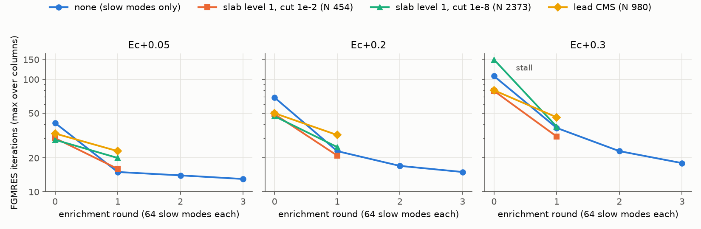
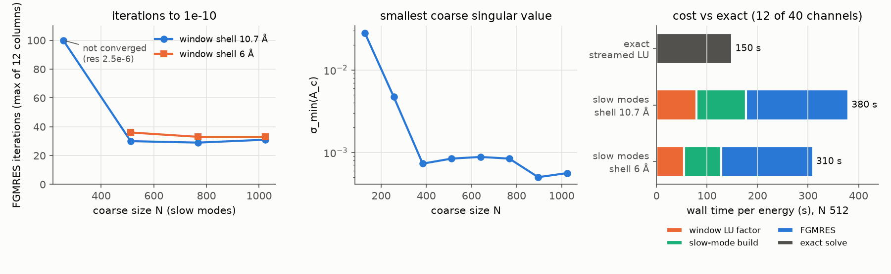
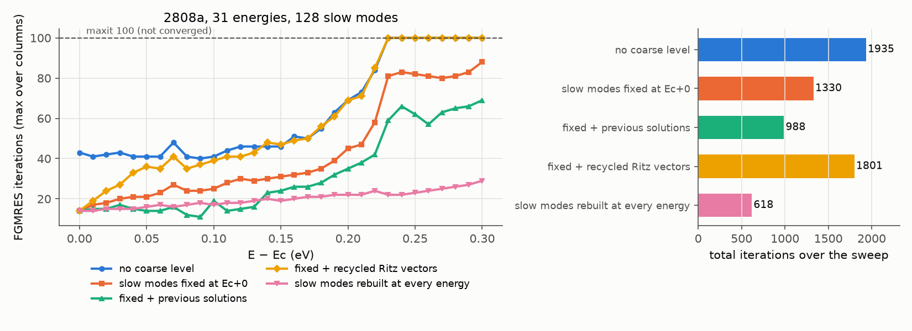
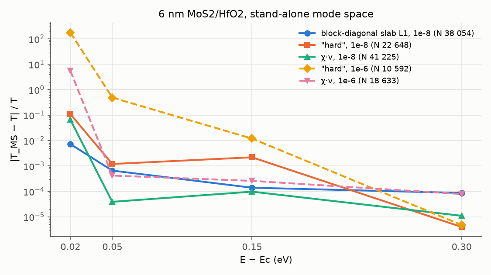
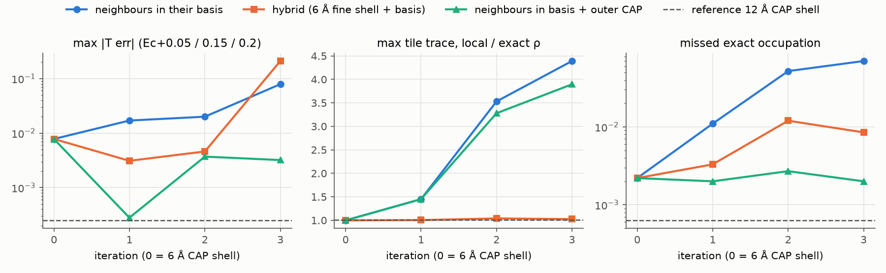
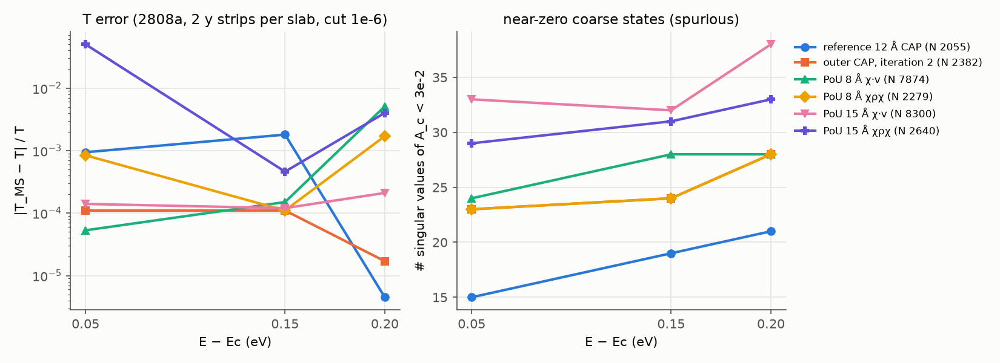

# Findings 2026-11-13: coarse levels, PoU on 6 nm, iterated tile bases

Today's most useful result is that a coarse space built from the smoother's slow error modes makes two-level FGMRES
converge on the 6 nm device, where every mode-space coarse level stalled. It is not faster than the exact solve yet.
Everything else tested today was negative or mixed: the PoU basis as a coarse level, the iterated tile bases, and
carrying a recycled coarse space across an energy sweep.

Sources: results_ms/gpu/slow/ (slow_2808a*.log, slow_6nm_t015*.log, sweep_recycle_2808a.log),
results_ms/gpu/pou/ (pou_ms_6nm_d4.log, tile_iter_2808a_*.log), sessions/2026-11-13-*.txt.

## Method: how the slow modes and the coarse solver are built

Code: `results_ms/gpu/slow/slow_modes.py` (prototype); smoother, two-level cycle and block FGMRES from
`release/qtx_modespace/src/qtx_modespace/schwarz.py`. Everything below is done at one energy E.

**The problem.** A(E) = E·S − H − Σ_L(E) − Σ_R(E); solve A ψ = b, b = injected lead channels (QTBM).

**The smoother M (CAP-Schwarz).** The device is covered by overlapping windows along x (16 Å wide; on 6 nm also cut
into 4 pieces in y with a transverse shell). Each window is closed by an absorbing CAP (−i·2 eV over 2 Å) on its
artificial cuts; windows touching a lead keep the exact Σ there. Each window matrix is LU-factorized once per energy
(dense complex64, on the GPU or on the host). Applying M to a vector r means: restrict r to every window, do a forward/
back substitution with that window's LU, and add the local solutions back on the window cores. So "apply M" = one
block LU solve per window, all windows independent.

**What the smoother is slow on.** One smoothing step changes the error e = ψ − x into T e with

  T = I − M A   (smoother error operator).

Components of e along eigenvectors of T with |θ| ≈ 1 or > 1 are barely damped or even amplified: in-band
standing waves whose wavelength is longer than a window, states that live on the window cuts, and resonances near E.
These "slow modes" are by definition what the coarse level must take care of. A mode-space basis only holds 50–70% of
each of them (section 1), which is why it is a poor coarse space.

**Computing the slow modes (block subspace iteration).**
1. Start with m random complex vectors Y (n × m), orthonormalize (QR).
2. Repeat q times: Y ← QR(op(Y)), where op is the error operator (each application of op = one smoother pass + one
   matvec with A per smoothing step, for all m columns at once).
3. Rayleigh–Ritz: eigen-decompose the small m × m matrix Yᴴ op(Y) → Ritz values θ (the asymptotic damping factors)
   and Ritz vectors. Y spans the dominant m-dimensional invariant subspace of op, i.e. the m slowest error modes.
   Cost per round: m (q + 1) applications of op (m 64, q 3: 256; m 128, q 3: 512).

**Building the coarse space in rounds (enrichment).** Start from Q₀ = empty (or a mode-space basis U).
- Round 1 uses op = T² (two smoothing steps, no coarse level yet).
- Round r ≥ 2 uses the error operator of the full two-level cycle with the current coarse space,
  E_Q = T (I − P_c A) T,  P_c = Q (Qᴴ A Q)⁻¹ Qᴴ,
  so each round targets exactly what the current two-level method still does badly.
- The m new vectors are orthogonalized against Q (twice) and appended: Q ← [Q, QR(W)]. These are global vectors,
  dense over the whole device (a "slab" variant that cuts W into slab blocks was tested and is worse).

**The coarse solver.** Galerkin, exactly as for mode space: A_c = Qᴴ A Q (N × N, dense, N = 512 on 6 nm), LU-factorized
once; the coarse correction is r ↦ Q A_c⁻¹ Qᴴ r.

**The two-level preconditioner and outer solver.** For a residual r:
  z = M r  (pre-smoothing) → z += Q A_c⁻¹ Qᴴ (r − A z)  (coarse correction) → z += M (r − A z)  (post-smoothing).
This preconditions a block flexible GMRES on all injected columns at once, x₀ = Q A_c⁻¹ Qᴴ b, tolerance 1e-10.

**Practical recipe per energy:** factor window LUs → 2–4 rounds of subspace iteration (64–128 vectors each) → A_c
and its LU → block FGMRES. The modes depend on E (smoother and A both do) and are best rebuilt at every energy; on
2808a that costs ~1 s, on 6 nm ~20–25 s per round of 128, since a smoother pass streams all window LUs regardless of
the number of columns.

## 1. Coarse level from slow smoother modes (2808a, then 6 nm)

- **Mode space is only half a coarse space.** Every mode-space basis (N 454–2373, including lead CMS) holds only
  50–70% of each slow mode, almost independent of N.
- **On 2808a the slow modes alone win.** 64–192 of them beat every mode-space basis by 2–4x in iterations
  (Ec+0.3: 98–107 → 14–18 its). Adding a mode-space base makes the enriched level worse, because its spurious
  Galerkin eigenvalues remain.
- **The slow modes are tied to the energy they were built at.** Moving 0.05 eV away loses half the gain. A mode-space
  base plus reused slow modes holds up over ±0.05–0.1 eV.
- **Cost on 2808a:** with m 64, q 3 the build roughly breaks even at Ec+0.05 and is ahead where the smoother is weak.
- **6 nm, Ec+0.15 (the case that stalled):** this is the first coarse level that converges.
  - N 512 (8 rounds of 128 modes): 24–30 its to 1e-10, ψ error 7.8e-10. It saturates there: N 768 and 1024 give the
    same counts.
  - N 256 is not enough (residual 2.5e-6 after 100 its), so the number of modes needed grows with the device.
  - Wall time is about 380 s (factor 79 + build ~90 + FGMRES 203) against 137–163 s for the exact streamed LU. It
    converges but is not yet faster.
  - Shrinking the transverse window shell from 10.7 to 6 Å cuts LU memory by 42% (117 → 68 GB) for +4–6 its, about
    310 s in total.

## 2. Energy sweep with a recycled coarse space (2808a, Ec+0…0.3, 31 energies)

| Coarse level | Total its | Solve time |
|---|---|---|
| None | 1935 (stalls at ≥ Ec+0.25) | 211 s |
| Slow modes fixed at Ec+0 | 1330 | 154 s |
| Fixed modes + previous solutions | 988 | 118 s |
| Fixed modes + recycled Ritz vectors | 1801 (stalls) | 211 s |
| **Slow modes rebuilt at every energy** | **618** | **99 s** (build ~1 s per energy) |

Rebuilding the slow modes at each energy wins everywhere, so there is no reason to carry the space across energies.
The Ritz vectors, as selected, damage the coarse level; the cause is not verified.

## 3. PoU slab basis on 6 nm, stand-alone mode space (cut 1e-8)

| Basis | N | Ec+0.02 | Ec+0.05 | Ec+0.15 | Ec+0.3 |
|---|---|---|---|---|---|
| Block-diagonal slab level 1, 1e-8 | 38 054 | +7.3e-3 | −6.6e-4 | −1.4e-4 | −8.7e-5 |
| "hard", 1e-8 | 22 648 | −1.1e-1 | +1.2e-3 | +2.2e-3 | −4.0e-6 |
| χ·v, 1e-8 | 41 225 | −6.6e-2 | −3.9e-5 | +9.8e-5 | +1.1e-5 |
| "hard", 1e-6 | 10 592 | +176 | +0.49 | −1.2e-2 | +4.8e-6 |
| χ·v, 1e-6 | 18 633 | +5.5 | +4.2e-4 | +2.6e-4 | +7.9e-5 |

- **χ·v:** T error is 10–20x lower than the block-diagonal basis at Ec+0.05 and Ec+0.3, about the same at Ec+0.15,
  and worse at Ec+0.02 (deep tunnelling, T ≈ 1e-8).
- **"hard":** 40% fewer columns, but worse T error except at Ec+0.3.
- **Galerkin does not find what the span holds:** χ·v contains the exact ψ 3–4x better than the block-diagonal basis,
  yet the Galerkin ψ error of the strong channels stays at 1e-2 to 1.8.
- **Takeaway:** a mixed gain for stand-alone use, nothing like the clear improvement on 2808a. As a coarse level for
  FGMRES (2808a, 12 November) PoU never helped.

## 4. Iterated tile bases (2808a, cut 1e-6, `tile_iter.py`): all negative

Reference: the 12 Å CAP-shell level 1 (8 tiles), N 2264, T error 1e-4 to 2.5e-4.

| Basis (old 8 tiles) | N | Missed exact occupation | Local / exact trace | T err Ec+0.05 / 0.15 / 0.2 |
|---|---|---|---|---|
| Reference, 12 Å CAP shell | 2264 | 6.3e-4 | 0.997–1.008 | −2.5e-4 / −8.1e-5 / +1.9e-4 |
| Iteration 0, 6 Å CAP shell | 6400 | 2.2e-3 | 0.935–0.998 | +7.4e-3 / +7.8e-3 / −3.4e-3 |
| "basis" env, iteration 3 | 2101 | 7.0e-2 | 1.06–4.39 | −8.6e-3 / +4.4e-3 / +7.9e-2 |
| "hybrid" env, iteration 1 | 1692 | 3.3e-3 | 0.997–1.004 | −3.1e-3 / +1.0e-4 / −1.7e-4 |
| "hybrid" env, iteration 3 | 1803 | 8.5e-3 | 1.002–1.025 | −2.1e-1 / +5.1e-4 / −5.1e-4 |
| Outer CAP, iteration 1 | 2262 | 2.0e-3 | 1.005–1.450 | −1.1e-4 / −2.1e-4 / −2.8e-4 |
| Outer CAP, iteration 3 | 3273 | 2.0e-3 | 1.064–3.895 | +3.2e-3 / +1.5e-3 / +2.4e-3 |

| Basis (y2 tiles: 2 y strips per slab) | N | T err Ec+0.05 / 0.15 / 0.2 | σ(A_c) < 3e-2 |
|---|---|---|---|
| Reference, 12 Å CAP shell | 2055 | +9.4e-4 / +1.8e-3 / +4.5e-6 | 15 / 19 / 21 |
| Outer CAP, iteration 2 | 2382 | +1.1e-4 / +1.1e-4 / +1.7e-5 | 23 / 24 / 28 |
| PoU ramp 8 Å, χ·v | 7874 | −5.3e-5 / −1.5e-4 / +5.1e-3 | 24 / 28 / 28 |
| PoU ramp 8 Å, χρχ | 2279 | −8.4e-4 / +1.1e-4 / −1.7e-3 | 23 / 24 / 28 |
| PoU ramp 15 Å, χ·v | 8300 | −1.4e-4 / +1.2e-4 / −2.1e-4 | 33 / 32 / 38 |
| PoU ramp 15 Å, χρχ | 2640 | −5.0e-2 / −4.6e-4 / +4.0e-3 | 29 / 31 / 33 |

- **Neighbours in their basis:** the iteration diverges (trace up to 4.4x exact, missed occupation 1e-2 → 7e-2), the
  same failure as `tile_scf.py` on 3 November.
- **Hybrid (fine 6 Å shell plus neighbour bases beyond it):** the trace stays right and the basis is smaller, but
  missed occupation is 5x higher and the iteration does not settle.
- **Neighbours' CAP projected into their basis, all tiles updated together:** the basis grows every iteration; on the
  y2 tiles iteration 2 is the best tile variant today (~1e-4), but the iteration does not converge (40–65% of each new
  vector outside the previous span).
- **Cluster ρ with a PoU restriction:** χ·v swells to ~8000 columns with no better T error; χρχ is about as good as
  the reference at 8 Å and worse at 15 Å. The cluster ρ over-occupies the centre tile by 1–11% in trace.
- **Spurious coarse states are never reduced:** 15–38 singular values of A_c below 3e-2, all almost real with 6–7 eV
  fine residual; a wider ramp makes it worse.
- **Common cause:** a neighbour represented only by its basis vectors lets extra states into the energy window. The
  slab PoU with a fine extended embedding did much better, but that comparison is across different cuts and
  partitions, so it is an inference rather than a controlled test.

## Relation to adaptive / bootstrap AMG (papers/AMG/)

The slow-mode coarse level is the adaptive AMG idea; the closest published method is DD-αAMG for the lattice
Wilson–Dirac operator (non-Hermitian, indefinite). Checked against the texts (Frommer et al. 2014, sections 3.3–5):

- **Adaptive (smoothed) aggregation:** run the smoother on D u = 0 from random vectors; what survives is the near
  kernel and becomes the test vectors; build a method, test it the same way, add the new vectors. = our round 1 (T²)
  and later rounds (cycle error operator).
- **Bootstrap AMG:** additionally uses eigenvectors of the coarse system (lifted, smoothed) as test vectors.
- **Lüscher's inexact deflation (2007) / DD-αAMG setup (Alg. 4.1):** random vectors, 3 passes of the SAP (red-black
  multiplicative Schwarz) smoother, then n_inv times: build P and D_c, apply the cycle (M_SAP π_L + P D_c⁻¹ Pᴴ) to the
  vectors. Almost exactly our construction: Schwarz smoother, vectors refined with the current cycle.
- **The difference is how the vectors are used:** they "chop up" the N test vectors (~20–30) over lattice blocks
  (aggregates, 4⁴ sites) into a sparse, block-local P, so the coarse system is sparse and can be recursed (2–4 levels on
  64⁴ lattices). We keep the vectors global (dense Q, dense A_c, two levels). This rests on **local coherence**
  (Lüscher 2007, sect. 5): the low modes are locally well approximated by a few fields per block, so block projections
  of a few modes contain all the others.

What this means here:
- Our "slab" variant (slow modes cut into slab blocks) is the aggregation step; on 2808a it was worse than global
  vectors (round 1: 16–20 / 24–30 / 34–41 vs 11–15 / 18–23 / 29–37 its). The QCD near kernel sits at λ ≈ 0 of a
  massive operator; ours is the set of in-band states at E (oscillatory, Helmholtz-like), where local coherence is
  expected to be weaker.
- Global vectors do not scale (64 on 2808a, 512 on 6 nm, dense). The next test is Lüscher's local-coherence experiment:
  take a subset of the slow modes, project onto blocks (slabs, slab pairs, Schwarz windows), measure how well the
  remaining slow modes lie in the block span, as a function of block size and vectors per block.

Papers: 2007_Luescher_local_coherence_deflation_low_quark_modes (arXiv:0706.2298), 2007_Luescher_deflation_acceleration
(0710.5417), 2010_Babich_..._adaptive_MG_Wilson_Dirac (1005.3043), 2011_Brandt_..._bootstrap_AMG (SIAM J. Sci. Comput.,
author copy), 2011_Bolten_..._bootstrap_AMG_Markov_chains (1004.1451), 2014_Frommer_..._DD-alphaAMG (1303.1377),
2013_Frommer_..._DD-alphaAMG_multilevel (1307.6101).

## Conclusions

1. For the solver, use slow-mode coarse spaces rebuilt at each energy. Mode space is better treated as a separate
   single-shot product than as the coarse level.
2. On 6 nm the next targets are cost: fewer or cheaper smoother passes, and less LU memory to stream from the host.
3. Stop iterating tile bases with neighbours represented through their basis vectors.
